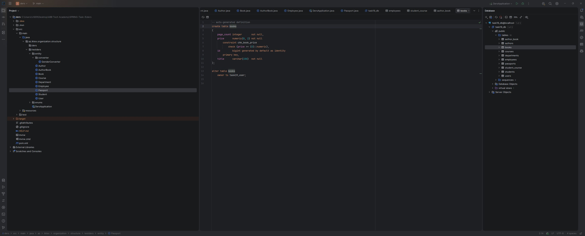
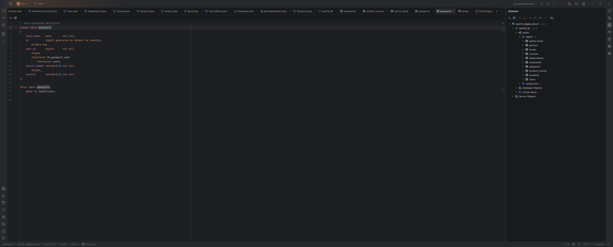
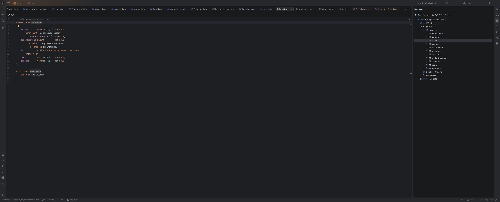
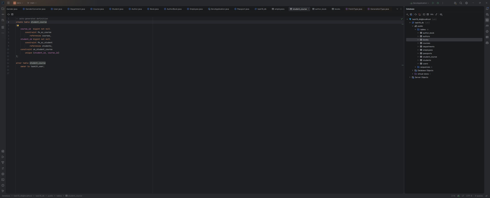
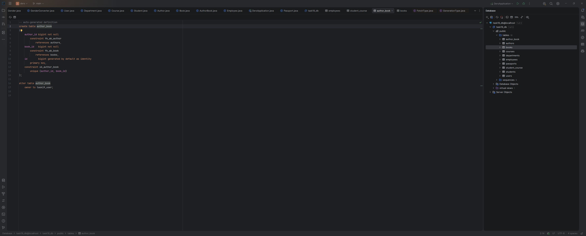

# SPRING-Task-3

JPA entity əlaqələri: OneToOne, OneToMany/ManyToOne və ManyToMany-nin iki variantı.

## Əlaqələr

| Əlaqə | Sahib tərəf | Silinmə qaydası |
| --- | --- | --- |
| User — Passport | Passport | User silinəndə pasport silinir. Əksi yox. |
| Department — Employee | Employee | Şöbə silinəndə işçilər silinir. Əksi yox. |
| Student — Course | Student | Tələbə silinəndə kurslar qalır, yalnız əlaqə sətirləri silinir. |
| Author — AuthorBook — Book | AuthorBook | Müəllif və ya kitab silinəndə yalnız ona aid əlaqələr silinir. |

Şöbə ilə birlikdə işçilərin silinməsi bu tapşırığın şərtidir. User.passport,
Department.employees və Author/Book.authorBooks üçün orphanRemoval aktivdir.

GenderConverter Java-dakı MALE/FEMALE dəyərlərini bazada 1/2 kimi saxlayır.
Naməlum ID üçün IllegalArgumentException atılır.

## PostgreSQL

Layihənin əsas qovluğunda `.env.example` faylını `.env` adı ilə kopyalayın.
Oradakı parol yalnız lokal tədris mühiti üçündür; `.env` Git-ə daxil edilmir.

```powershell
docker compose up -d --wait
```

- Host: localhost
- Port: 5433
- Database: task19_db
- User: task19_user
- Password: `.env` faylındakı POSTGRES_PASSWORD

Konteyner yalnız `127.0.0.1` üzərindən açıqdır. Bu tapşırıq üçün ayrıca volume və baza yaradılır.

## Layihə

Java 21, Maven, Spring Boot 4.1.1. `ders/pom.xml` faylını IntelliJ-də açın. Başlanğıc sinif: `az.iktex.organization.structure.testders.DersApplication`.

```powershell
cd ders
.\mvnw.cmd test
.\mvnw.cmd spring-boot:run
```

Spring Web əlavə edilməyib: tapşırıqda HTTP server və endpoint tələb olunmur.
Tətbiq başladıqdan sonra exit code 0 ilə bağlana bilər. PostgreSQL konteyneri ayrıca işləyir.

`ddl-auto=create` və `show-sql=true` tapşırığa uyğun aktivdir.
**Hər başlanğıcda, o cümlədən testlərdə, cədvəllər yenidən yaradılır və əvvəlki məlumatlar itir.
Bu konfiqurasiyanı vacib məlumatların olduğu bazaya yönəltməyin.**

## Baza

9 entity və 10 cədvəl yaradılır:

```text
users             passports
departments       employees
students          courses          student_course
authors           books            author_book
```

`student_course` ayrıca entity deyil, `@JoinTable` vasitəsilə yaranır.
`author_book` isə ayrıca AuthorBook entity-sidir.

- FK: fk_passport_user, fk_employee_department, fk_sc_student, fk_sc_course,
  fk_ab_author, fk_ab_book.
- Cütlərin unikallığı: uk_student_course, uk_author_book.
- CHECK: chk_employee_salary (`salary > 0`), chk_book_price (`price >= 0`).
- Maaş numeric(10,2), kitabın qiyməti numeric(8,2) kimi saxlanılır.
- passport.user_id unikaldır: bir istifadəçiyə yalnız bir pasport bağlana bilər.

Bütün əlaqələr LAZY elan olunub. User.passport inverse OneToOne olduğuna görə
Hibernate onu əlavə sorğu ilə dərhal yükləyə bilər; təkcə LAZY annotasiyası
bu tərəfdə gec yüklənməyə zəmanət vermir.

## Yoxlama

```powershell
cd ders
.\mvnw.cmd clean test
```

15 test: 1 contextLoads və 14 converter/əlaqə testi. Əlaqə testləri real
PostgreSQL bazasında işləyir, hər testin məlumatları transaction rollback ilə geri alınır.
Saxlanma, cascade silinməsi, orphanRemoval, əlaqənin çıxarılması və əks tərəfin
silinməməsi yoxlanılır. Bunlar əlavə REST endpoint tələb etmir.

İntelliJ Database panelindəki ekran görüntüləri:












## Asılılıqlar

- Spring Data JPA: JPA/Hibernate inteqrasiyası və repository infrastrukturu.
- PostgreSQL Driver: Java tətbiqinin PostgreSQL ilə JDBC bağlantısı.
- Lombok: compile zamanı getter, setter və konstruktor generasiyası.
